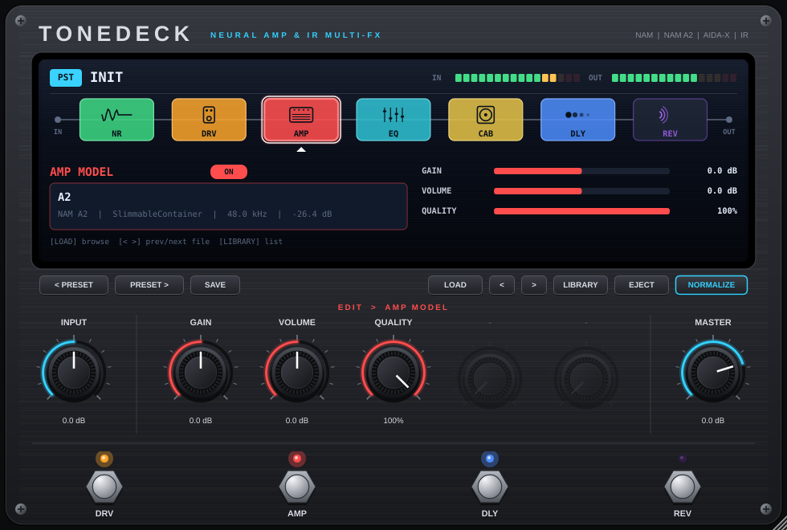

# ToneDeck — Neural Amp & IR Multi-FX

Multiefectos de guitarra con la flexibilidad de una HX Stomp y la simpleza de una pedalera compacta. Carga **capturas NAM** (incluida la arquitectura **A2**), **AIDA-X**, **GuitarML / Proteus** e **IRs** de gabinete, y tiene 17 efectos propios, dos caminos en paralelo, snapshots, looper, afinador y MIDI learn.



Formatos: **VST3** (Windows / macOS / Linux), **AU** (macOS), **CLAP**, **LV2** (Linux) y **aplicación Standalone**.

## La pedalera

**Grilla de 2 × 8 celdas, hasta 16 bloques por preset.**
- Fila de arriba = **camino A**. Fila de abajo = **camino B** en paralelo: la señal se divide antes del primer bloque de B y se vuelve a juntar después del último, en el nodo **M** (mezclador con nivel y paneo de cada camino). Ideal para dos amplis, dos gabinetes o un efecto en paralelo.
- **Clic en una celda vacía** → agregar bloque. **Arrastrar** → mover (si la celda está ocupada, intercambia). **Doble clic** → on/off. **Clic derecho** → menú (cambiar tipo, cargar archivos, asignar a footswitch, quitar).
- Las **6 perillas** controlan el bloque seleccionado; INPUT y MASTER son fijas.

### Bloques

| Categoría | Bloques |
|---|---|
| Dinámica | Noise Gate, Compresor |
| Drive | Clean Boost, Overdrive (tipo TS), Fuzz — con oversampling 2× |
| Ampli / Gabinete | **Capture** (NAM, NAM A2, AIDA-X, GuitarML/Proteus) · **Gabinete con 2 IR** (A/B con blend) |
| EQ | Tone Stack, EQ paramétrico |
| Modulación | Chorus, Flanger, Phaser, Trémolo |
| Filtro | Wah (manual, auto-wah por envolvente o LFO) |
| Delay / Reverb | Delay estéreo / ping-pong, Reverb con pre-delay (ambos con "trails": la cola sigue al apagarlos) |
| Utilidad | Volumen / Paneo |

El bloque **CAPTURE** carga cualquier modelo y se rotula según el equipo capturado (dato de TONE3000 o `gear_type` del archivo .nam): **PED** pedal, **AMP** ampli, **RIG** ampli + gabinete, **OUT** outboard. Al cargar desde TONE3000 o la biblioteca, las capturas de pedal se ubican solas antes del ampli (corriendo la cadena) y las de ampli reemplazan al ampli. Si soltás el archivo sobre una celda concreta, va ahí. Al cargar un **RIG** el plugin apaga el CAB que viene después (ya trae parlante) y al cargar un **AMP** lo vuelve a encender.

Las capturas no reproducen efectos que se mueven en el tiempo (chorus, flanger, phaser, trémolo, delay, reverb, wah): sólo el color y la saturación del equipo. El plugin avisa cuando el nombre lo sugiere y propone el bloque equivalente.

En las capturas, las perillas PARAM 1/2 aparecen si el modelo es condicionado (AIDA-X/GuitarML) y QUALITY si es NAM A2.

### Directo

- **4 footswitches con 3 páginas** (botón `FS:`):
  - **STOMP**: cada uno prende/apaga el bloque que le asignes (clic derecho en el footswitch), o hace tap tempo o abre el afinador.
  - **SNAPSHOTS**: 4 variaciones por preset (on/off y perillas de todos los bloques) que cambian al instante. Se guardan solos al pasar de uno a otro.
  - **LOOPER**: REC/PLAY/DUB, STOP, CLEAR, EXIT. Hasta 40 s.
- **Afinador** (botón TUNER o un footswitch): silencia la salida mientras afinás.
- **Tap tempo**: ajusta el tiempo de todos los delays del preset.
- **MIDI learn**: clic derecho en cualquier perilla o footswitch → *MIDI Learn* y mové un control de tu controladora. **Program Change** carga presets.

## TONE3000

El botón **TONE3000** conecta el plugin con tu cuenta de [tone3000.com](https://www.tone3000.com):

- **Elegir tono en el navegador**: se abre TONE3000, elegís un tono y ToneDeck descarga sus modelos a `Library/TONE3000/<tono>/` y lo carga en el bloque seleccionado (AMP o DRV; las IR van solas al CAB). Si el tono trae varias capturas, te deja elegir cuál.
- **Mis favoritos / descargados / subidos, Populares, Nuevos**: listas de tu cuenta para cargar tonos sin salir del plugin.
- La primera vez te pide tu **clave pública** (`t3k_pub_...`, se crea en *Settings → API Keys*). Nunca pegues la clave secreta (`t3k_cs_...`).
- El login usa OAuth con PKCE y una dirección local (`127.0.0.1`), así que tu contraseña nunca pasa por el plugin. La sesión queda guardada en el archivo de ajustes de ToneDeck.

## Uso

- **Clic en un bloque** de la pantalla → lo selecciona y las 5 perillas pasan a controlarlo.
- **Doble clic o clic derecho en un bloque** → encender / apagar. Los 4 footswitches hacen lo mismo con DRV, AMP, DLY y REV.
- **Cargar archivos**: botón `LOAD`, clic en el recuadro del nombre de archivo, o **arrastrar y soltar** sobre la pantalla (`.nam/.json` van al AMP, o al DRV si lo soltás sobre ese bloque; `.wav` van al CAB).
- **`<` `>`**: pasa al archivo anterior / siguiente de la misma carpeta — ideal para comparar capturas descargadas de TONE3000.
- **`LIBRARY`**: lista en pantalla todos los modelos o IRs de tu carpeta de biblioteca (incluye subcarpetas). Por defecto `Documentos/ToneDeck/Library`; se cambia con *CHANGE FOLDER* y se recuerda entre sesiones.
- **`NORMALIZE`**: iguala el volumen de los modelos NAM que traen metadato de loudness (a -18 dB), como hace el plugin oficial de NAM.
- **Presets**: `SAVE` guarda todo (parámetros + rutas de modelos/IR) en `Documentos/ToneDeck/Presets`. `< PRESET` / `PRESET >` los recorre. Los mensajes **MIDI Program Change** cargan el preset N (en orden alfabético).
- La ventana se puede **redimensionar** (50 %–200 %) desde la esquina inferior derecha.

### Detalles técnicos

- Los modelos se cargan y pre-calientan en un hilo aparte y se intercambian sin bloquear el audio (con un fade-in corto, sin clicks).
- Si el DAW corre a una frecuencia distinta a la del modelo (casi siempre 48 kHz), se re-muestrea internamente con filtros anti-alias; la latencia (16 muestras) se informa al host.
- Entrada mono (canal izquierdo), salida estéreo. Funciona en pistas mono o estéreo.
- Archivos `.json` que en realidad son exportaciones NAM también se detectan automáticamente.

## Compilar

Requisitos: CMake ≥ 3.22, Git y un compilador C++20 (Visual Studio 2022, Xcode 14+, o GCC 11+/Clang 14+).

```bash
bash scripts/fetch_deps.sh          # descarga JUCE, NAM Core, Eigen, RTNeural, CLAP (versiones fijadas)
cmake -S . -B build -DCMAKE_BUILD_TYPE=Release
cmake --build build --config Release --target ToneDeck_All
```

Los binarios quedan en `build/ToneDeck_artefacts/Release/` (VST3, AU, CLAP, LV2, Standalone).

En Linux instalá antes: `libasound2-dev libx11-dev libxrandr-dev libxinerama-dev libxcursor-dev libxext-dev libxcomposite-dev libfreetype-dev libfontconfig1-dev libgl-dev`.

**Sin compilar nada:** subí esta carpeta a un repositorio de GitHub; el workflow de `.github/workflows/build.yml` compila Windows, macOS (universal Intel + Apple Silicon) y Linux automáticamente y deja los instaladores en la pestaña *Actions*. Si creás un tag `v1.0.0` publica un Release con los zips.

### Tests

```bash
cmake -S . -B build -DTONEDECK_BUILD_TESTS=ON
cmake --build build --target ToneDeckTests
./build/ToneDeckTests_artefacts/Release/ToneDeckTests salida/ modelo1.nam modelo2.json ...
```

Procesa audio sintético por toda la cadena a 44.1/48/96 kHz con distintos tamaños de buffer, verifica guardado/restauración del estado y genera capturas de la interfaz.

## Instalación

| Sistema | VST3 | Otros |
|---|---|---|
| Windows | `C:\Program Files\Common Files\VST3\` | CLAP: `C:\Program Files\Common Files\CLAP\` |
| macOS | `/Library/Audio/Plug-Ins/VST3/` | AU: `/Library/Audio/Plug-Ins/Components/` · CLAP: `/Library/Audio/Plug-Ins/CLAP/` |
| Linux | `~/.vst3/` | LV2: `~/.lv2/` · CLAP: `~/.clap/` |

En macOS, si el plugin no firmado aparece bloqueado: `xattr -dr com.apple.quarantine ToneDeck.vst3`.

## Licencias

- [JUCE](https://juce.com) — AGPLv3 o licencia comercial. Para uso personal no hay problema; si vas a distribuir el plugin cerrado necesitás licencia de JUCE.
- [NeuralAmpModelerCore](https://github.com/sdatkinson/NeuralAmpModelerCore) — MIT
- [RTNeural](https://github.com/jatinchowdhury18/RTNeural) — BSD-3
- [Eigen](https://eigen.tuxfamily.org) — MPL2
- [clap-juce-extensions](https://github.com/free-audio/clap-juce-extensions) — MIT

ToneDeck no está afiliado a TONE3000, Neural Amp Modeler ni AIDA DSP; sólo lee sus formatos de archivo abiertos.
